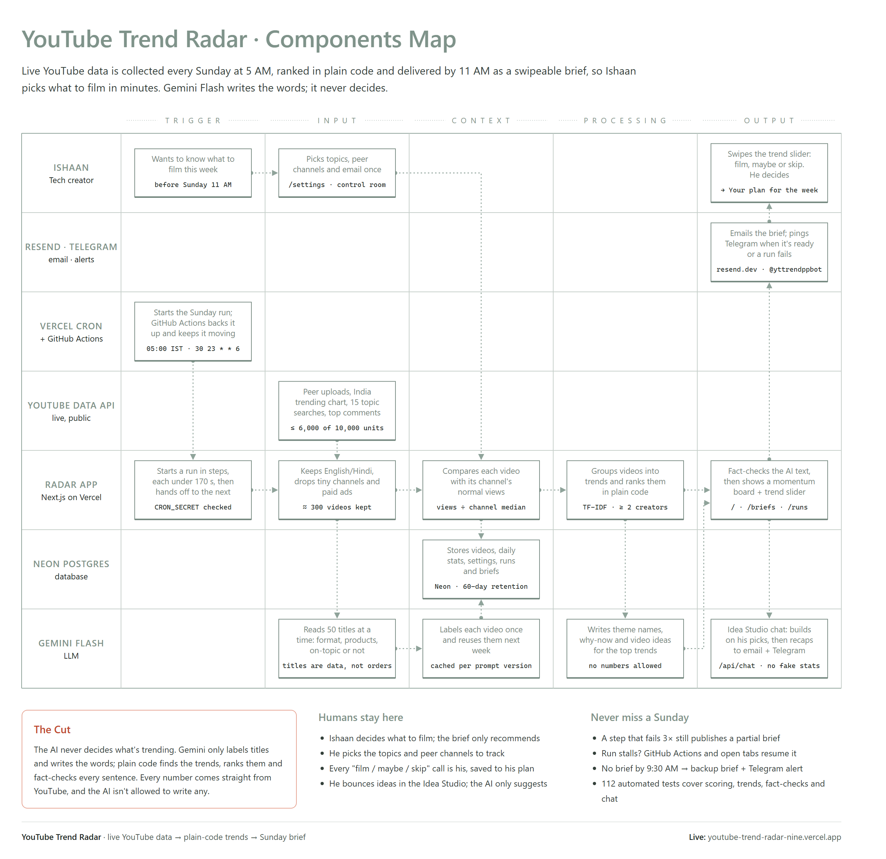
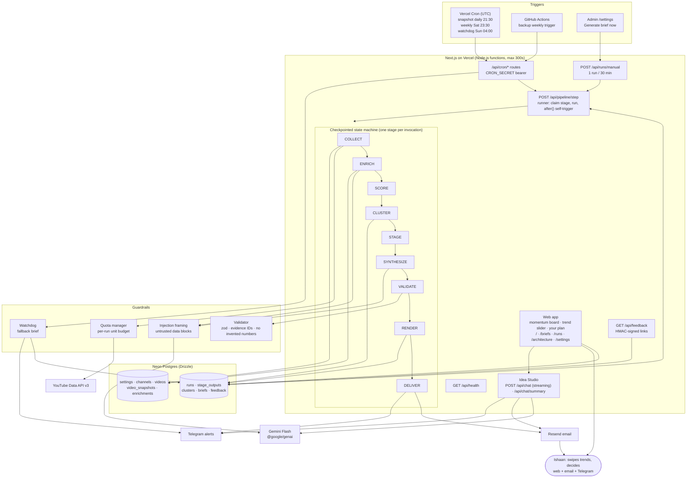

# Components Map: YouTube Trend Radar

This map shows every component, how data moves between them, and what happens when something fails. The same diagram is rendered live at [`/architecture`](https://youtube-trend-radar.vercel.app/architecture). Its source is [`lib/architecture.ts`](lib/architecture.ts), and a unit test keeps this file in sync with it.

## Swimlane map (PDF / PNG)



One-page version: [docs/components-map.pdf](docs/components-map.pdf) · [PNG](docs/components-map.png). Source: [`scripts/build-components-map.mjs`](scripts/build-components-map.mjs), so run `npm run map` and re-render after changing the system (see README).

## Diagram (Mermaid)



## Diagram (ASCII)

```
 TRIGGERS                                   VERCEL (Next.js 16, Node.js functions, <=300s each)
 ─────────                                  ─────────────────────────────────────────────────────────────────────
 Vercel Cron (UTC) ──┐                      /api/cron/snapshot  (daily 21:30)  → refresh stats <14d, retention 60d
   21:30 daily       │                      /api/cron/weekly    (Sat 23:30)    → create run (idempotent) ─┐
   23:30 Sat         ├─ Bearer CRON_SECRET ─/api/cron/watchdog  (Sun 04:00)    → fallback brief if none   │
   04:00 Sun         │                                                                                    │
 GitHub Actions ─────┘ (backup weekly)      POST /api/runs/manual (admin, 1 per 30 min) ─────────────────┤
 Admin /settings ──── session cookie ──────┘                                                              ▼
                                            POST /api/pipeline/step  ── claim stage (UPDATE…WHERE status) ──┐
                                               │  run ONE stage (<170s), save stage_outputs               │
                                               └─ after(): fetch /api/pipeline/step for the next stage ◄──┘

   COLLECT ──► ENRICH ──► SCORE ──► CLUSTER ──► STAGE ──► SYNTHESIZE ──► VALIDATE ──► RENDER ──► DELIVER ──► DONE
      │           │          │          │          │            │              │            │          │
      │ quota     │ inj.     │ pure     │ TF-IDF   │ lifecycle  │ injection    │ zod, IDs,  │ HTML +   │ Resend email
      │ manager   │ framing  │ math     │ entities │ + score    │ framing      │ no numbers │ JSON     │ Telegram alert
      ▼           ▼                                               ▼
  YouTube Data API v3     Gemini Flash (@google/genai, structured JSON, ≤3 concurrent, 429 backoff)

 NEON POSTGRES (Drizzle)
 ───────────────────────
 settings · channels · videos · video_snapshots · enrichments            ← COLLECT / ENRICH / snapshot cron
 runs · stage_outputs · clusters · briefs · feedback                      ← runner / CLUSTER / STAGE / RENDER / feedback

 CLIENTS
 ───────
 Ishaan ◄── web: /  /briefs/[id]  /runs  /architecture  /settings     ◄── email (Resend) ◄── feedback links (HMAC) ──► /api/feedback
```

## Components

| Component | Role |
|---|---|
| **Vercel Cron** | Three UTC schedules (Hobby allows each at most daily, firing somewhere within the hour): `snapshot` daily 21:30 (03:00 IST), `weekly` Sat 23:30 (Sun 05:00 IST), `watchdog` Sun 04:00 (09:30–10:29 IST). Sends `Authorization: Bearer CRON_SECRET`. |
| **GitHub Actions** | `.github/workflows/backup-trigger.yml` calls `/api/cron/weekly` at the same time as the Vercel cron, then pumps `/api/runs/resume` every 45 s until the run finishes. `weeklyJob` is idempotent: no second run is created within 12 h, and only one run can be active. |
| **Pipeline runner** | `POST /api/pipeline/step` returns 202, then runs one stage (or one checkpointed slice of one) inside `after()` and triggers itself for the next. Stages are claimed with a conditional `UPDATE`, so duplicate invocations can't run the same stage. |
| **COLLECT** | Resolves handles (`channels.list?forHandle`) → peer uploads (`playlistItems`) → `mostPopular` chart (IN/28, optional) → ≤15 `search.list` → `videos.list` hydrate in batches of 50 → `channels.list` hydrate, drops channels under 5K subscribers or blocked → per-channel median of the last 15 uploads (cached 7 d) → top comments for the 60 biggest outliers → snapshots. |
| **ENRICH** | Gemini Flash, 50 videos per call (max 350 per run): `format`, canonical `entities` (Hindi/Hinglish normalised), `topic_key`, `topic_summary`. Output is zod-validated, with one repair retry before falling back to `format: "other"`. Enrichments are cached per video across runs. |
| **SCORE** | Pure code: `age_hours`, `views_per_hour`, `outlier_multiple`, `engagement_rate`, `velocity_72h`. |
| **CLUSTER** | Pure code: dominant-entity grouping, then TF-IDF cosine ≥ 0.35 or shared top entity → merge. Needs ≥ 2 channels; each channel contributes at most 2 videos to the stats. Produces `ClusterStats`. |
| **STAGE** | Pure code: matches last week (same entity or cosine ≥ 0.5), computes week-over-week channel growth, assigns lifecycle and score (weights in `config/weights.json`). Picks the top 5 non-saturated clusters and up to 5 "skip". |
| **SYNTHESIZE** | One Gemini Flash call. The input is qualitative signal bands (no raw numbers), titles and audience questions. The output is theme, why-now and angles, with no numbers. |
| **VALIDATE** | zod schema, evidence IDs ⊂ cluster, no digits outside the cluster stats/entity names, unique themes, snapshots < 30 h. One repair call; anything still failing renders stats-only. |
| **RENDER** | Builds the brief JSON plus inline-styled HTML (web + email). The template injects every statistic. |
| **Web app** | Studio-themed UI. The home page is a hero with a momentum board (views vs. channel normal, per trend), a swipeable trend slider (scroll-snap, arrows, dots, keyboard, touch) and a synced detail panel. The film / maybe / skip decision auto-advances the slider and fills **Your plan**. Also: archive grid, run log, how-it-works and Admin "control room". |
| **Idea Studio** | Slide-over chat on the brief. Ideas Ishaan ticks under "Ideas for your video" (saved per brief in his browser) plus his film / maybe / skip calls and the brief itself are sent as context to `POST /api/chat`, which streams a Gemini Flash reply (same Flash fallback chain; untrusted-data framing; no invented stats). `POST /api/chat/summary` has Gemini recap the discussion (structured JSON) and sends it to the email and Telegram chat configured on the server. Both routes are rate-limited per client. |
| **DELIVER** | Resend email and Telegram are best-effort; their failures are recorded in `briefs.delivery` and never fail the run. |
| **Neon Postgres** | `settings`, `channels`, `videos`, `video_snapshots`, `enrichments`, `runs`, `stage_outputs`, `clusters`, `briefs`, `feedback`. |
| **Guardrails** | Quota manager (per-run unit budget, charged before each call), injection framing (untrusted data blocks, delimiter neutralising), validator, watchdog, env validation at boot, log redaction. |

## Data-flow lifecycle

1. **Trigger:** cron, GitHub Actions or the admin creates a `runs` row (`pending`, stage `COLLECT`) and fires `/api/pipeline/step`.
2. **Collect:** YouTube data is upserted into `channels` and `videos`, and a `video_snapshots` row is written per video. The candidate list, comment questions and the creator's own uploads go into `stage_outputs[COLLECT].payload`.
3. **Enrich:** Gemini labels are written to `enrichments`, keyed by video and reused in later weeks.
4. **Score:** per-video metrics go into `stage_outputs[SCORE].payload`.
5. **Cluster:** `clusters` rows are written with `ClusterStats`, and the run's old rows are replaced, so the stage is idempotent.
6. **Stage:** `clusters.lifecycle`, `score`, `selection` (top/skip) and `matched_prev_cluster_id` are filled in.
7. **Synthesize:** the raw model output goes into `stage_outputs[SYNTHESIZE].payload`.
8. **Validate:** the safe narrative (or `stats_only`) is written to `clusters.narrative`.
9. **Render:** a `briefs` row is written (`complete` or `degraded`) with its `html` and `json`.
10. **Deliver:** email and Telegram are sent, and `briefs.delivered_at` and `delivery` are set. The run becomes `done` or `degraded`.
11. **Read:** `/` shows the latest brief. Feedback clicks are written to `feedback`.
12. **Daily:** snapshot cron adds new `video_snapshots` rows (enabling velocity) and deletes videos and snapshots older than 60 days.

## Failure handling

| Failure | Detection | Response |
|---|---|---|
| Function killed / timeout mid-stage | `stage_outputs.status='running'` with a heartbeat older than 6 min | The next step call re-claims the stage and counts it as a failed attempt. The daily cron re-kicks stalled runs. |
| Stage throws | try/catch in runner | `attempts+1`, retried after 10 s. After 3 failures the run takes the **DEGRADED** path: it skips straight to RENDER with whatever exists and the brief is marked `degraded`. |
| Long stage (COLLECT/ENRICH) | time budget per invocation | Checkpoints progress in `stage_outputs.payload` and re-invokes itself, up to 15 invocations. |
| YouTube `403 quotaExceeded` | typed client | Stops all further calls immediately, continues with the data already collected, and adds a coverage note. |
| Per-run quota budget reached | quota manager (charged before each call) | Same as above, so the daily 10K units are never overshot. |
| `mostPopular` chart error or empty | try/catch | Logged and skipped; the run doesn't depend on it. |
| Comments disabled (403/404) | typed client | That video is skipped. |
| Handle doesn't resolve | `channels.list?forHandle` returns nothing | The handle is dropped and logged, and shown in the brief footer. |
| HTTP 429 / 5xx / network (any service) | retry wrapper | 20 s timeout (Gemini 90–120 s), up to 4 attempts, exponential backoff with jitter. |
| Gemini returns invalid JSON / schema | zod | One repair retry with the error. ENRICH then falls back to `format: "other"`; SYNTHESIZE falls back to stats-only cards. |
| Model invents numbers / cites foreign videos | validator | One regeneration with the errors, then offending sentences or IDs are dropped, else the card goes stats-only. |
| Prompt injection in titles/comments | framing | The content is sent only inside delimited JSON data blocks, with closing delimiters neutralised. Output IDs outside the batch are ignored. |
| Email / Telegram failure | result object | Recorded in `briefs.delivery`; the run still succeeds. |
| No brief by Sunday morning | watchdog cron | Publishes a **FALLBACK** brief (last week's non-saturated clusters with a red banner), marks the stuck run failed and alerts Telegram. |
| Self-trigger blocked by Vercel loop protection (HTTP 508) | `triggerStep` sees 508 | Logged as a pause, not an error. Quick stages already run back-to-back in one invocation. The run is continued by the GitHub Actions pump, by any open browser tab via `POST /api/runs/resume` (continues stalled runs only), by the daily cron, or by the watchdog driving it in-process. |
| Chat: Gemini quota out / overloaded | `streamChat` falls through the Flash models before streaming starts | Friendly "busy, try again later" message; nothing else is affected. |
| Chat flooding | per-client sliding window (25 messages / 10 min, 5 summaries / 10 min) | HTTP 429 with a retry hint. Summaries only go to the server-configured email and Telegram, never to an address from the request. |
| Duplicate triggers | run lock + 12 h weekly dedupe + stage claim | No-op. |
| Missing/invalid env vars | zod at boot (`instrumentation.ts`) and on first use | Logged by name only; `/api/health` reports which are missing. |
